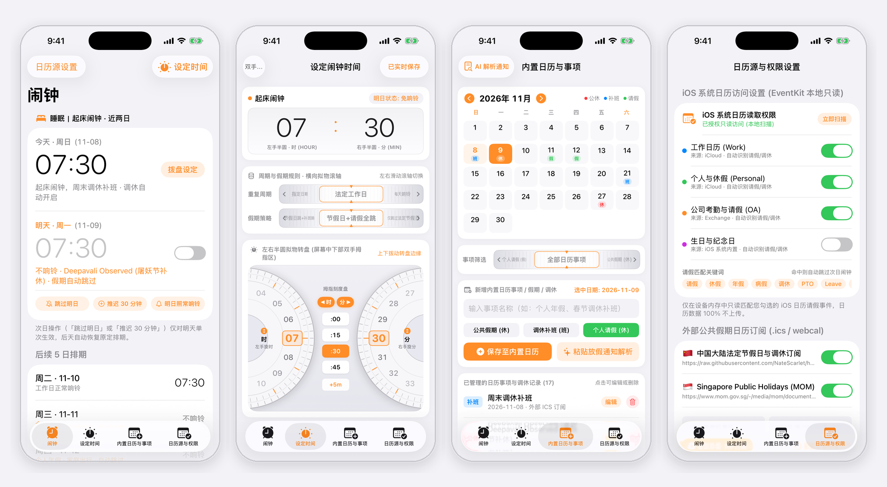

# VibeAlarm

**A 100% on-device, privacy-first iOS alarm with Apple Light Theme + Braun (Dieter Rams) industrial precision, built to understand public holidays, weekend makeup workdays, and personal leave.**

[](https://github.com/jstdlee/vibe-alarm/actions/workflows/ci.yml)


<p align="center">
  
</p>

> **Design principles**: a crisp **Apple Light Theme** (`#F5F5F7` alabaster canvas, `#FFFFFF` matte cards, `#FF5500` Braun International Orange accent) paired with **Dieter Rams / Braun machined-aluminum tactile UI**:
> - **Dual semi-circular rotary dials** anchored to the left (`HOUR 00–23`) and right (`MIN 00–59`) screen edges in the lower thumb zone, with knurled radial ticks and a sharp orange index needle.
> - **Horizontal mechanical rollers** replace traditional dropdowns for repeat mode, holiday policy, and calendar filtering — swipe or tap to step through options.
> - **Built-in calendar & events manager**, **external `.ics` subscriptions**, and **iOS Calendar (`EventKit`) access settings** are all reachable from the bottom tab bar, with every byte of data staying in the on-device App Group sandbox.

---

## iOS Simulator Screenshots (Apple Light Theme)

Captured by GitHub Actions on `macos-26` running the iOS Simulator in light appearance against a real build of `VibeAlarm.app`:

<p align="center">
  
  
  
  
  
</p>

| 1. Alarms (`TwoDayDashboardView`) | 2. Time Dial (`DualThumbTimeDialView`) |
| :---: | :---: |
|  |  |
| Spacious **Today** and **Tomorrow** hero cards show the live status (`RINGING`, `SKIPPED`, `DELAYED`) with the reason at a glance — a makeup workday auto-enabling the alarm, or a holiday auto-skipping it. A one-tap action bar (`Skip`, `+30m`, `+1h`, `Keep On`) overrides just tomorrow; the day after automatically restores the normal schedule. | Machined-aluminum **horizontal rollers** set the repeat mode and holiday policy. In the lower thumb zone, symmetric **semi-circular rotary dials** anchored to the screen edges let your left thumb spin the hour and your right thumb spin the minute, with a center column of quick-snap presets. |

| 3. Calendar (`HolidayCalendarView`) | 4. Sources (`SettingsView`) |
| :---: | :---: |
|  |  |
| A clean monthly grid marks each day with a compact `OFF` / `WRK` / `PTO` micro-pill. Tap any date to add, edit, or delete a holiday, makeup workday, or personal leave entry, or paste a notice for the on-device AI parser. | iOS Calendar (`EventKit`) access status, selectable local calendars, and leave keyword chips live alongside external `.ics` subscription toggles for statutory holiday feeds — plus the BYOK AI provider, model, Keychain-backed API key, and bedtime confirmation settings. |

| 5. Widgets (`WidgetAndBedtimeShowcaseView`) |
| :---: |
|  |
| A Home Screen `SystemMedium` widget shows both days with interactive `Skip` / `+30m` / `+1h` / `Restore` buttons — no need to open the app. A nightly bedtime confirmation notification previews tomorrow's status with the same one-tap actions available via long-press. |

---

## Core Features

1. **Dual semi-circular rotary dials + horizontal rollers** (`DualThumbTimeDialView`):
   - Left (`HOUR`) and right (`MIN`) machined-aluminum dials anchored to the screen edges with radial tick marks, an orange index needle, and `UIImpactFeedbackGenerator` tactile feedback.
   - Horizontal rollers replace dropdown menus for repeat mode and holiday policy.
2. **Built-in calendar & events manager** (`HolidayCalendarView`):
   - Monthly grid with `OFF` / `WRK` / `PTO` badges, full CRUD for holidays, makeup workdays, and personal leave, plus a BYOK AI notice parser.
3. **External `.ics` subscriptions & iOS Calendar (`EventKit`) access** (`SettingsView`):
   - On-device, read-only `EventKit` scanning of selected local/iCloud/Exchange calendars against custom leave keywords (`PTO`, `Leave`, `Vacation`, `Annual Leave`, `Day Off`, `Sick Leave`).
   - Built-in China statutory holiday and Singapore MOM public holiday feeds, plus any custom `.ics` / `webcal` link.
4. **One-tap next-day override, auto-restoring** (`NextDayOverride`):
   - `Skip` or delay tomorrow's alarm in one tap; the override is scoped to a single date (`targetDate = YYYY-MM-DD`) and automatically expires the day after, restoring the normal schedule.

---

## Architecture

- **`VibeAlarmCore`** — a dependency-free Swift package with the scheduling engine (`AlarmScheduleEngine`), models, the zero-network `.ics` parser (`ICSHolidayParser`), the BYOK LLM + offline natural-language holiday extractor (`BYOKHolidayService`), and the shared App Group persistence layer (`SharedAlarmStore`). Fully unit tested.
- **`iOS/App`** — the SwiftUI app target: five tabs (`Alarms`, `Time Dial`, `Calendar`, `Sources`, `Widgets`), the view model (`AppViewModel`), on-device `EventKit` access (`LocalCalendarManager`), and Keychain storage (`KeychainHelper`).
- **`iOS/Shared`** — code shared between the app and the widget extension: `AppIntents` for Siri/Shortcuts/interactive widget actions, the notification scheduler, app-wide constants, and the Braun/Apple color palette.
- **`iOS/Widget`** — the WidgetKit extension with `SystemSmall` and `SystemMedium` Home Screen widgets.

## Build & Test

```bash
git clone https://github.com/jstdlee/vibe-alarm.git
cd vibe-alarm

# Run the VibeAlarmCore unit tests
swift test --package-path VibeAlarmCore

# Generate the Xcode project and open it
brew install xcodegen
xcodegen generate
open VibeAlarm.xcodeproj
```

GitHub Actions (`macos-26` + Xcode) runs the `VibeAlarmCore` unit tests, builds the app and widget extension, captures real iOS Simulator screenshots in light mode, and packages an unsigned `.ipa` on every push. Download the `VibeAlarm-unsigned-ipa` artifact from the [CI workflow](https://github.com/jstdlee/vibe-alarm/actions/workflows/ci.yml) to sideload with AltStore, SideStore, Sideloadly, TrollStore, or a personal Apple developer certificate.

---

## License

MIT License © [jstdlee](https://github.com/jstdlee)
