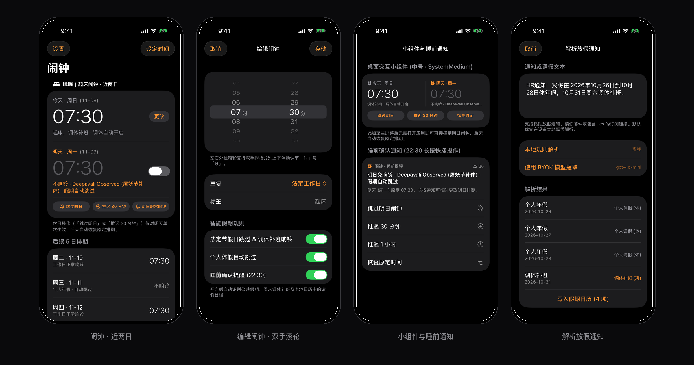
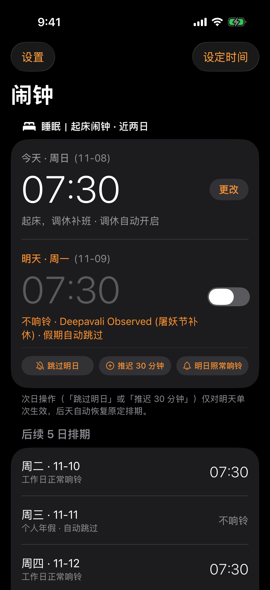
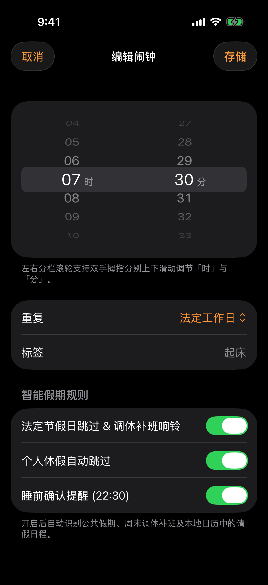
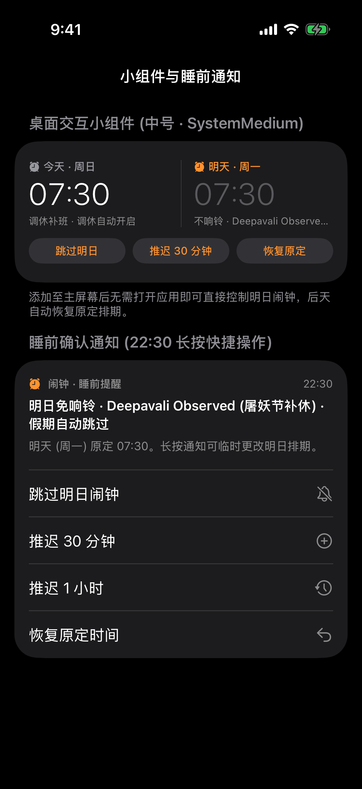
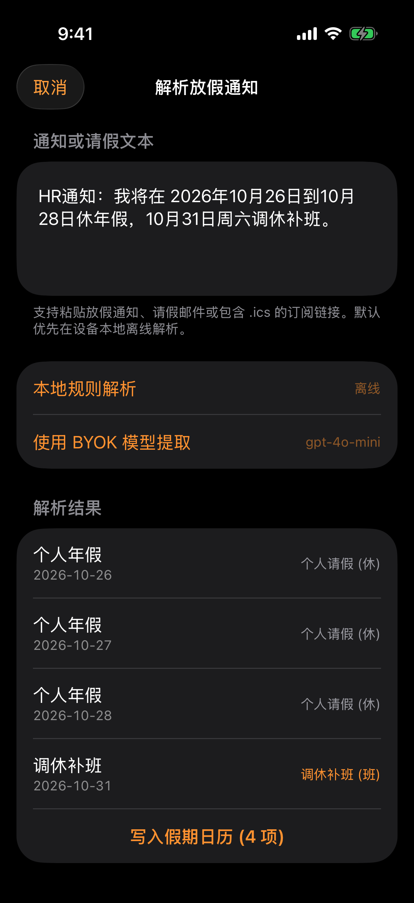

# Vibe 假期闹钟 (VibeAlarm)

**遵循 Apple Human Interface Guidelines (iOS Clock 原生暗色风格)、懂法定节假日、周末调休补班与个人请假的 100% 本地隐私优先 iOS 闹钟**

[](https://github.com/jstdlee/vibe-alarm/actions/workflows/ci.yml)


<p align="center">
  
</p>

> **设计原则**：延续 iOS 系统「闹钟 (`Clock`)」与「设置 (`Settings`)」原生克制风格——纯黑 OLED 背景 (`#000000`)、系统分组卡片 (`#1C1C1E`)、`56pt .light` 等宽时间数字与系统橙 (`#FF9F0A`) 强调色。不设任何云端后台 API，所有日历读取、节假日与调休判断、BYOK AI 提取及次日闹钟单次推迟/恢复均在 iPhone 本地沙盒 (`App Group`) 闭环完成。

---

## iOS Simulator 实机截图

以下截图均由 GitHub Actions `macos-26` 上的 Xcode iOS Simulator 直接运行编译后的 `VibeAlarm.app` 实机截取：

<p align="center">
  
  
  
  
</p>

| 1. 闹钟 · 近两日 (`TwoDayDashboardView`) | 2. 编辑闹钟 · 双手滚轮 (`DualThumbTimeDialView`) |
| :---: | :---: |
|  |  |
| 采用 iOS 系统「闹钟」原生大标题与 `.insetGrouped` 列表：聚焦**今天与明天（近两日）**排期，清晰标注「调休补班 · 调休自动开启」或「不响铃 · 屠妖节补休 · 假期自动跳过」，底部提供**跳过明日 / 推迟 30 分钟 / 明日照常响铃**单次覆盖操作，后天自动恢复原定排期。 | 原生模态表单 (`编辑闹钟`)：顶部为左右分列 3D 滚筒选择器，**左手拇指上下滑调 `时 (00–23)`**、**右手拇指上下滑调 `分 (00–59)`**；下方为标准 iOS 分组列表，一键设置重复周期（法定工作日 / 每天 / 自定义星期 / 指定日期）与智能假期开关。 |

| 3. 小组件与睡前通知 (`WidgetKit` + `AppIntents`) | 4. 解析放假通知与日历 (`BYOK` + `EventKit` + `ICS`) |
| :---: | :---: |
|  |  |
| **无需打开 App**：iOS 17+ 桌面交互小组件 (`SystemMedium` / `SystemSmall`) 直接展示今明两天状态并提供「跳过明日」「推迟 30m」「恢复原定」按钮；每晚 `22:30` 自动推送睡前确认通知，**长按通知**即可一键跳过或推迟明早闹钟。 | 原生分组列表交互：粘贴 HR 请假邮件、放假通知或 `.ics` 订阅链接，支持**本地规则离线解析**或调用保存在 **iOS Keychain** 的自带 API Key (`BYOK`) 提取假期与调休补班，并结合外部公共假期 `.ics` 与系统 `EventKit` 日历自动生效。 |

---

## 核心特性

1. **三源合一本地假期引擎**：结合 **外部公共假期 `.ics` 订阅**（内置中国国务院放假调休 & 新加坡 MOM 公共假期预设）、**本地系统日历只读扫描 (`EventKit`)** 与 **BYOK / 离线自然语言解析**，自动识别「法定节假日」「周末调休补班」与「个人休假」。
2. **单次推迟/跳过，后天自动恢复 (`NextDayOverride`)**：无论是点击「跳过明日」还是「推迟 30 分钟」，都只针对**明天那一次**生成带日期戳的临时覆盖 (`targetDate = YYYY-MM-DD`)；明天过后自动失效，**后天自动恢复原定排期**。
3. **左右手拇指双滚轮 (`DualThumbTimeDialSheet`)**：针对双手握持优化，左列调 `时`、右列调 `分`，配合系统触感反馈 (`UISelectionFeedbackGenerator`)。
4. **100% 本地隐私优先**：
   - **闹钟规则与排期状态**：保存在本地 `App Group` (`group.com.jstdlee.vibealarm`) JSON 文件，绝不上传。
   - **系统日历 (`EventKit`)**：仅在设备内存只读匹配请假关键词（请假 / 年假 / 休假 / PTO），绝不上传。
   - **BYOK API Key**：加密存储在 iOS 系统钥匙串 (`Keychain`, `ThisDeviceOnly`)，未配置时默认使用离线规则解析。

---

## 安装与编译指南

### 方式一：下载 GitHub Actions 自动编译的 `.ipa` 与 Simulator 截图

本仓库配置了 GitHub Actions (`macos-26` + Xcode)，每次提交都会自动运行 `VibeAlarmCore` 单元测试、在 iOS Simulator 中实机运行截图并打包未签名 `.ipa`：

1. 打开 [**GitHub Actions — CI 工作流页面**](https://github.com/jstdlee/vibe-alarm/actions/workflows/ci.yml)。
2. 点进最新一次构建记录，在底部 **Artifacts** 下载 **`VibeAlarm-unsigned-ipa`**，内含 `dist/VibeAlarm.ipa` 与 `dist/screenshots/` 实机截图。
3. 使用 **AltStore / SideStore / Sideloadly / TrollStore** 或个人 Apple 开发者证书签名安装到 iPhone。

### 方式二：从源码本地编译 (Xcode + XcodeGen)

```bash
git clone https://github.com/jstdlee/vibe-alarm.git
cd vibe-alarm

# 运行核心包单元测试
swift test --package-path VibeAlarmCore

# 生成 Xcode 工程并打开
brew install xcodegen
xcodegen generate
open VibeAlarm.xcodeproj
```

---

## License

MIT License © [jstdlee](https://github.com/jstdlee)
