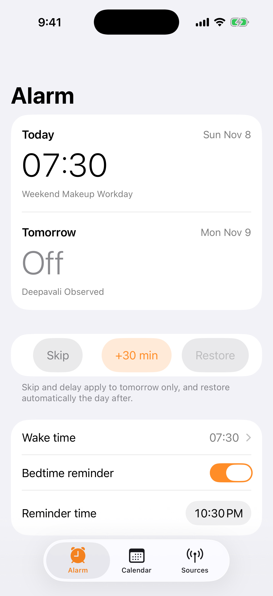
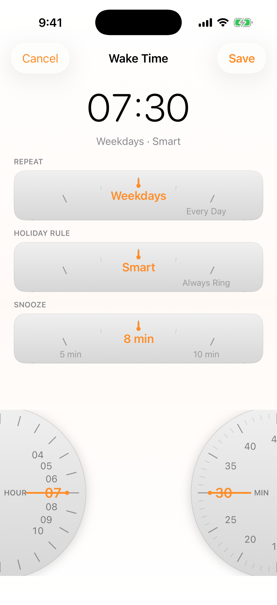
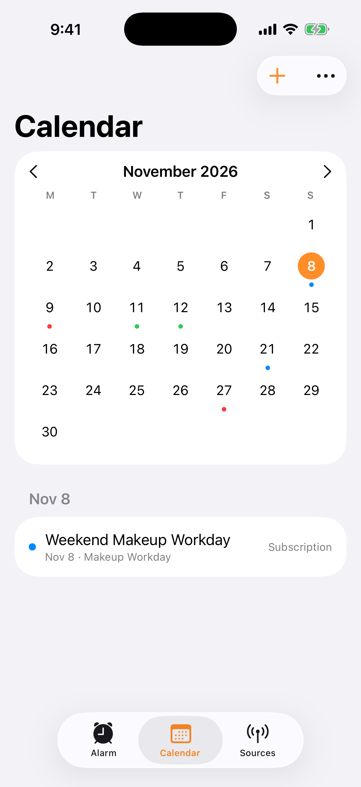
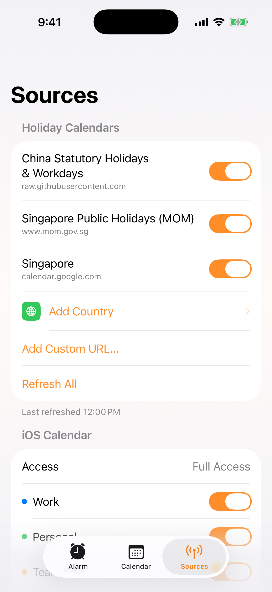
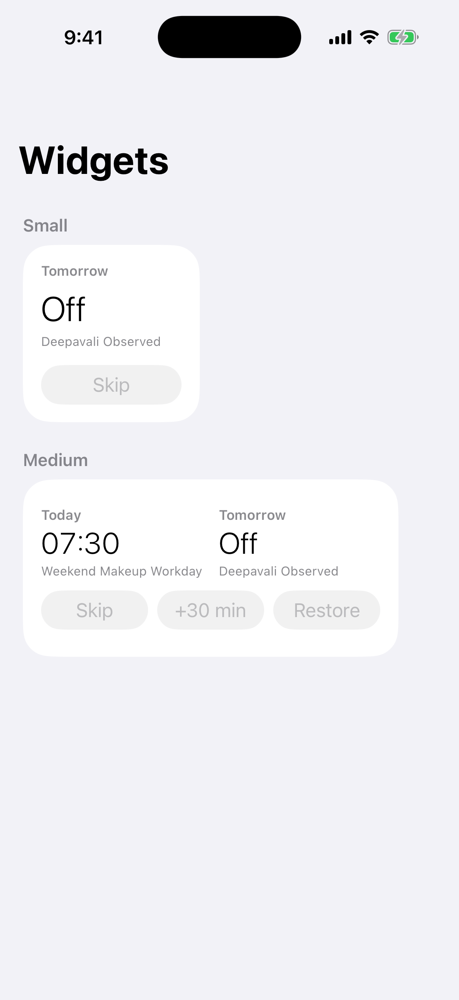

# VibeAlarm

**A 100% on-device, privacy-first iOS alarm built in genuine Apple Human Interface Guidelines style, that understands public holidays, weekend makeup workdays, and personal leave.**

[](https://github.com/jstdlee/vibe-alarm/actions/workflows/ci.yml)


> **Design principles**: native `List`/`Form` with the `.insetGrouped` style, system semantic colors (`Color(.systemGroupedBackground)`, `.primary`, `.secondary`), and exactly one accent color (system orange). No gradients, no badges, no decorative chrome.
> - **Two skeuomorphic controls, and only two**: a pair of semicircular rotary dials (`SemicircleDial`) anchored to the left and right screen edges for picking the hour and minute, and horizontal thumbwheel rollers (`ThumbwheelRoller`) that replace dropdown menus for repeat mode and holiday policy.
> - **Built-in calendar & events manager**, **external `.ics` subscriptions**, and **iOS Calendar (`EventKit`) access settings** are all reachable from the bottom tab bar, with every byte of data staying in the on-device App Group sandbox.

---

## iOS Simulator Screenshots (Apple Light Theme)

Captured by GitHub Actions on `macos-26` running the iOS Simulator in light appearance against a real build of `VibeAlarm.app`:

<p align="center">
  
  
  
  
  
</p>

| 1. Alarm (`TwoDayDashboardView`) | 2. Wake Time (`TimeEditorView`) |
| :---: | :---: |
|  |  |
| A plain `List` shows **Today** and **Tomorrow** with the effective wake time in large light digits, or `Off` / `Skipped`, plus a short reason line when relevant (a holiday, a makeup workday, a delay). `Skip` / `+30 min` / `Restore` apply to tomorrow only and restore automatically the day after. | The signature interaction: two `SemicircleDial` half-discs anchored to the screen edges for the hour and minute, and two `ThumbwheelRoller` rows below for repeat mode (`Workdays` / `Every Day` / `Weekends` / `Custom` / `Once`) and holiday rule (`Smart` / `Always Ring`). |

| 3. Calendar (`HolidayCalendarView`) | 4. Sources (`SettingsView`) |
| :---: | :---: |
|  |  |
| A custom month grid marks each day with a small colored dot (red = public holiday, blue = makeup workday, green = personal leave). Tap a day to filter the native list below it; swipe to delete, tap to edit, or import entries from pasted text with the on-device AI parser. | iOS Calendar (`EventKit`) access status and per-calendar toggles, editable leave keywords, `.ics` subscription toggles for statutory holiday feeds, and the BYOK AI provider / model / Keychain-backed API key settings — all in native `Form` sections. |

| 5. Widgets (`WidgetGalleryView`) |
| :---: |
|  |
| The small and medium Home Screen widgets, reusing the exact SwiftUI views from `iOS/Shared/WidgetViews.swift`. The medium widget shows both days with interactive `Skip` / `+30 min` / `Restore` buttons — no need to open the app. A nightly bedtime reminder notification previews tomorrow's status with the same one-tap actions available via long-press. |

---

## Core Features

1. **Two reusable skeuomorphic controls, used nowhere else** (`iOS/Shared/SemicircleDial.swift`, `iOS/Shared/ThumbwheelRoller.swift`):
   - `SemicircleDial` — a half-disc rotary dial anchored to a screen edge, rotated with a circular drag gesture, with fine tick marks and a fixed orange index notch. Used for the hour (0–23) and minute (0–59).
   - `ThumbwheelRoller` — a horizontal cylinder of text options with the center value bold and neighbors fading toward the edges. Replaces dropdowns for repeat mode and holiday rule.
2. **Built-in calendar & events manager** (`HolidayCalendarView`):
   - Month grid with colored day markers, full CRUD (title, date, kind, note) for holidays, makeup workdays, and personal leave, plus a BYOK AI notice parser.
3. **External `.ics` subscriptions & iOS Calendar (`EventKit`) access** (`SettingsView`):
   - On-device, read-only `EventKit` scanning of selected local/iCloud/Exchange calendars against custom leave keywords (`PTO`, `Leave`, `Vacation`, `Annual Leave`, `Day Off`, `Sick Leave`).
   - Built-in China statutory holiday and Singapore MOM public holiday feeds, plus any custom `.ics` / `webcal` link.
4. **One-tap next-day override, auto-restoring** (`NextDayOverride`):
   - `Skip` or delay tomorrow's alarm in one tap; the override is scoped to a single date (`targetDate = YYYY-MM-DD`) and automatically expires the day after, restoring the normal schedule.

---

## Architecture

- **`VibeAlarmCore`** — a dependency-free Swift package with the scheduling engine (`AlarmScheduleEngine`), models, the zero-network `.ics` parser (`ICSHolidayParser`), the BYOK LLM + offline natural-language holiday extractor (`BYOKHolidayService`), and the shared App Group persistence layer (`SharedAlarmStore`). Fully unit tested.
- **`iOS/App`** — the SwiftUI app target: three tabs (`Alarm`, `Calendar`, `Sources`), the wake time editor (`TimeEditorView`), the view model (`AppViewModel`), on-device `EventKit` access (`LocalCalendarManager`), and Keychain storage (`KeychainHelper`).
- **`iOS/Shared`** — code shared between the app and the widget extension: the two skeuomorphic controls, the pure SwiftUI widget views (`WidgetViews.swift`), `AppIntents` for Siri/Shortcuts/interactive widget actions, the notification scheduler, and app-wide constants.
- **`iOS/Widget`** — the WidgetKit extension with `SystemSmall` and `SystemMedium` Home Screen widgets, built from the shared widget views.

## Build & Test

```bash
git clone https://github.com/jstdlee/vibe-alarm.git
cd vibe-alarm

# Run the VibeAlarmCore unit tests
swift test --package-path VibeAlarmCore

# Generate the Xcode project and open it
brew install xcodegen
xcodegen generate
open VibeAlarm.xcodeproj
```

GitHub Actions (`macos-26` + Xcode) runs the `VibeAlarmCore` unit tests, builds the app and widget extension, captures real iOS Simulator screenshots in light mode, and packages an unsigned `.ipa` on every push. Download the `VibeAlarm-unsigned-ipa` artifact from the [CI workflow](https://github.com/jstdlee/vibe-alarm/actions/workflows/ci.yml) to sideload with AltStore, SideStore, Sideloadly, TrollStore, or a personal Apple developer certificate.

---

## License

MIT License © [jstdlee](https://github.com/jstdlee)
