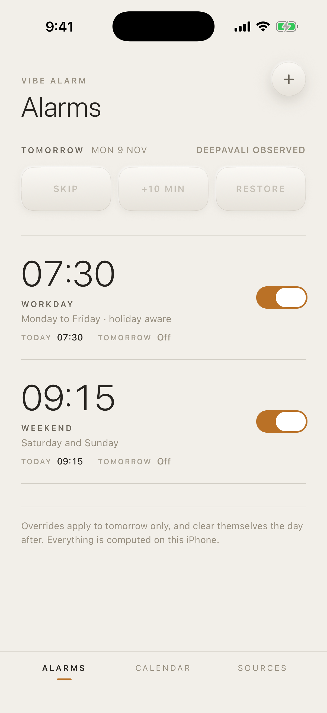
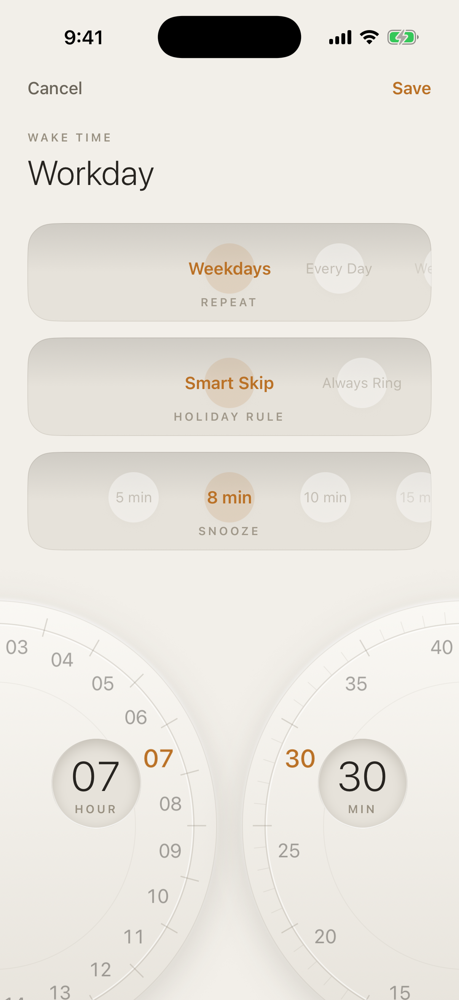
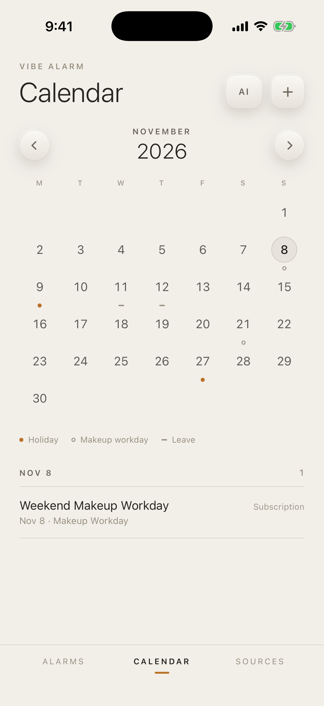
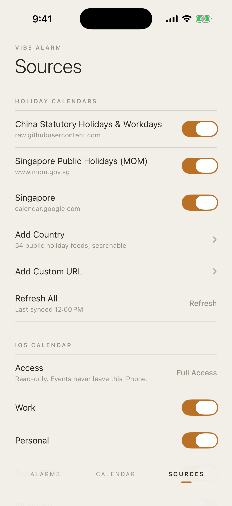
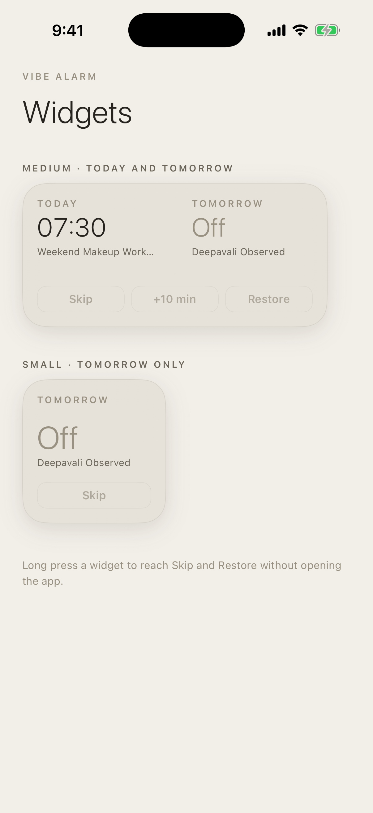
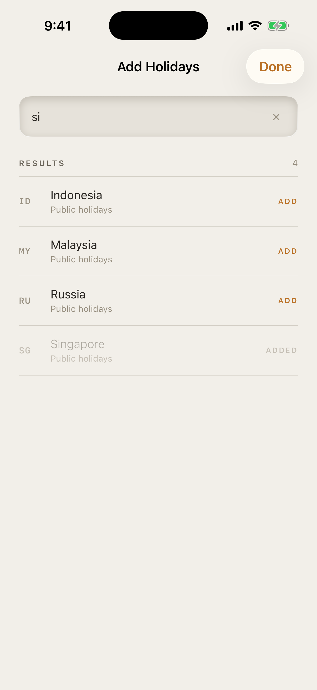
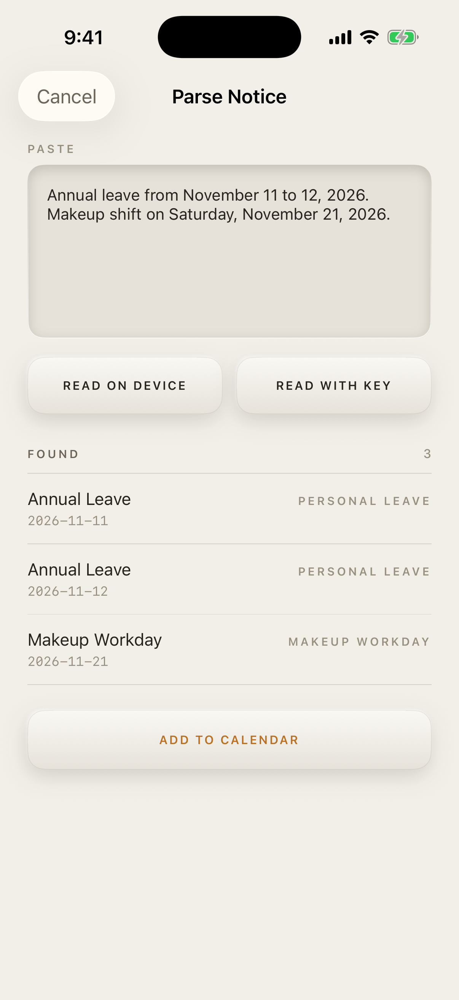

# VibeAlarm

**A 100% on-device, privacy-first iOS alarm that understands public holidays, weekend makeup workdays and personal leave.**

[](https://github.com/jstdlee/vibe-alarm/actions/workflows/ci.yml)


> **Design language: machined matte volumes.** A warm plaster paper ground, matte discs that sit in a recessed well and cast one soft shadow from a single light source, engraved hairline grooves, and exactly one accent — a warm amber used for the active index and the single primary action. Depth comes from shadow and well, never from borders or glass. Motion is weighted: a dial turns like a heavy object.

---

## iOS Simulator Screenshots

Captured by GitHub Actions on `macos-26` against a real build of `VibeAlarm.app`, in light appearance. The same seven screens are also captured on a 375 x 667 phone (`docs/screenshots/small/`).

<p align="center">
  
  
  
  
  
</p>

<p align="center">
  
  
</p>

| 1. Alarms | 2. Wake Time |
| :---: | :---: |
|  |  |
| The home screen is an alarms list. Above it sit three machined quick keys — `Skip`, `+10 min`, `Restore` — that act on tomorrow only. Each row shows the alarm's large time, its repeat summary, today and tomorrow's effective state, and a real toggle. | Two large engraved discs fill the lower half for the hour and the minute, sized for a thumb on each edge. Repeat, Holiday Rule and Snooze are horizontal rotary controls with the caption set into the bottom middle of the control itself, not a title row above it. |

| 3. Calendar | 4. Sources |
| :---: | :---: |
|  |  |
| A month grid marks each day in the same engraved language: an amber dot for a public holiday, a ring for a makeup workday, a dash for personal leave. Tap a day to filter the entries below; add, edit or delete any entry. | Holiday feeds, each with a toggle, plus `Add Country` into the searchable catalog, a custom `.ics` URL, and a refresh. iOS Calendar access is read-only with one toggle per calendar. Everything that is on or off is a plain toggle, never a dial. |

| 5. Widgets | 6. Add Holidays |
| :---: | :---: |
|  |  |
| Small and medium Home Screen widgets built from the same shared views, with interactive `Skip`, `+10 min` and `Restore` buttons. A bedtime notification previews tomorrow with the same one-tap actions. | A catalog of 54 national public holiday feeds. Search by country name or code and tap `Add`; the feed becomes an ordinary `.ics` subscription. |


Paste a leave notice or an HR email. The on-device parser (or your own API key, if you set one) turns it into dated entries — personal leave, public holiday, makeup workday — before anything is saved.

---

## Core Features

1. **Alarms list with next-day quick keys** — `Skip`, `+10 min` and `Restore` apply to tomorrow only and clear themselves the day after.
2. **Skeuomorphic controls used sparingly and consistently** (`iOS/Shared`):
   - `MachinedDisc` — the large engraved disc used for the hour and the minute.
   - `CompactRoller` — a horizontal rotary control whose caption sits at the bottom middle of the control, used for repeat mode, holiday rule and snooze interval.
3. **Three-source holiday engine, all on device**:
   - External `.ics` subscriptions, including China's statutory holidays and makeup workdays, Singapore MOM, and a searchable catalog of 54 national feeds. Google feeds are classified so observances and regional-only days do not silently skip a workday.
   - Read-only `EventKit` scanning of chosen calendars against leave keywords.
   - A BYOK parser for pasted notices, with an offline rule-based fallback and the key held in the iOS Keychain.
4. **Snooze interval** — stored in the shared App Group store, default `8` minutes, used by the notification snooze action and the scheduler.
5. **Privacy** — no backend, no account, no analytics. Alarm rules, overrides and calendar entries live in the App Group sandbox; events never leave the phone.

---

## Architecture

- **`VibeAlarmCore`** — a dependency-free Swift package: scheduling engine, models, `.ics` parser, holiday catalog, BYOK service, shared store. Unit tested.
- **`iOS/App`** — the SwiftUI app: `AlarmListView`, `TimeEditorView`, `HolidayCalendarView`, `SettingsView`, `HolidayCatalogSearchSheet`, `BYOKInputSheet`.
- **`iOS/Shared`** — controls, widget views, App Intents for Siri and Shortcuts, and the notification scheduler.
- **`iOS/Widget`** — the WidgetKit extension with small and medium widgets.

## Build & Test

```bash
git clone https://github.com/jstdlee/vibe-alarm.git
cd vibe-alarm

swift test --package-path VibeAlarmCore

brew install xcodegen
xcodegen generate
open VibeAlarm.xcodeproj
```

GitHub Actions (`macos-26` + Xcode) runs the core tests, builds the app and widget extension, captures real Simulator screenshots on two screen sizes, and packages an unsigned `.ipa`. Download the `VibeAlarm-unsigned-ipa` artifact from the [CI workflow](https://github.com/jstdlee/vibe-alarm/actions/workflows/ci.yml) to sideload it.

---

## License

MIT License © [jstdlee](https://github.com/jstdlee)
