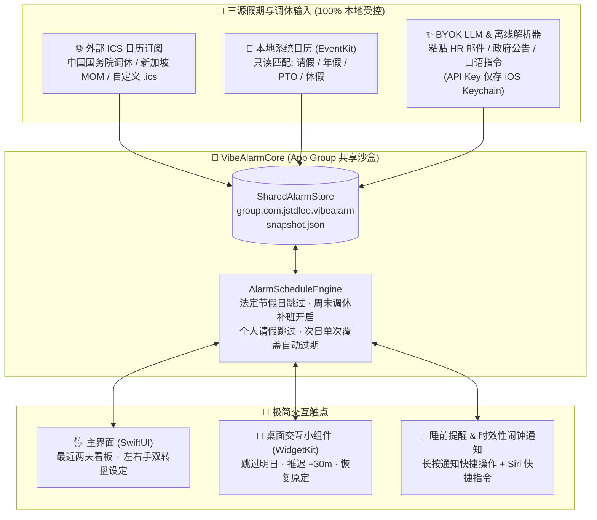

# Vibe 假期闹钟 (VibeAlarm)

**懂公共假期、调休补班与个人请假的 100% 本地隐私优先 iOS 原生智能闹钟**

[](https://github.com/jstdlee/vibe-alarm/actions/workflows/ci.yml)


<p align="center">
  
</p>

> **核心理念**：不设任何云端后台 API、不依赖集中式 Agent 服务，所有日历读取、节假日与调休判断、BYOK AI 提取及次日闹钟单次推迟/恢复全部在 iPhone 本地沙盒 (`App Group`) 闭环完成。

---

## 📱 界面预览 / GUI Gallery

<p align="center">
  
  
  
  
</p>

| 1. 最近两天智能看板 (`TwoDayDashboardView`) | 2. 左右手双转盘设定 (`DualThumbTimeDialView`) |
| :---: | :---: |
|  |  |
| 界面聚焦**今天与明天（最近两天）**的闹钟状态：清晰标注「屠妖节补休 · 假期跳过」或「国庆调休补班 · 自动开启」，并提供**跳过明日 / 推迟 +30m / 推迟 +1h / 一键恢复**单次覆盖按钮，后天自动恢复原定排期。 | 专为大屏双手握持设计的**左右拇指独立滚轮**：**左手上下滑调 `Hour (00–23)`**、**右手上下滑调 `Minute (00–59)`**，配刻度触感震动 (`Haptics`) 与 `:00/:15/:30/:45/+5m` 快捷分针键，下方一键切换周期与指定日期。 |

| 3. 桌面交互小组件 & 睡前长按通知 (`WidgetKit` + `AppIntents`) | 4. BYOK AI 录假期 & 三源合一假期日历 (`BYOK` + `EventKit` + `ICS`) |
| :---: | :---: |
|  |  |
| **无需打开 App**：iOS 17+ 桌面小组件直接显示今明两天状态并提供「跳过明日」「推迟 +30m」「恢复原定」实体交互按钮；每晚 `22:30` 自动推送睡前确认通知，**长按通知**即可一键跳过或推迟明早闹钟。 | 粘贴 HR 请假邮件、政府公告或一句话指令，支持 **本地零网络秒级解析** 或使用存放在 **iOS Keychain** 的自带 API Key 调用 LLM 提取假期与 `.ics` 链接；同时支持订阅外部公共假期与只读扫描本地 `EventKit` 日历请假。 |

---

## ✨ 为什么做 Vibe 假期闹钟？

iOS 系统自带闹钟有两个长期痛点：
1. **不懂“法定节假日 + 周末调休补班 + 个人年假”**：放假忘关闹钟被吵醒；更糟的是**关了闹钟后假期结束忘了重新打开**，或者遇到周六/周日法定调休补班忘了定闹钟导致迟到。
2. **单手/双手调时间反人类**：系统小滚轮居中且窄，睡前想把明天闹钟临时推迟半小时或跳过一天，操作繁琐且改动了原有时间后次日还得手动改回来。

**Vibe 假期闹钟** 用四个设计彻底解决：
- **三源合一本地假期引擎**：结合 **外部公共假期 `.ics` 订阅**（内置中国国务院放假调休 & 新加坡 MOM 公共假期预设）、**本地系统日历直读 (`EventKit`)** 与 **BYOK AI 自然语言录入**，自动算出每天究竟是「法定公休」「周末调休补班」还是「个人年假/病假/PTO」。
- **单次推迟/跳过，后天自动恢复 (`NextDayOverride`)**：无论是点击「跳过明日」还是「推迟 +30m / +1h」，都只针对**明天那一次**生成带日期戳的临时覆盖 (`targetDate = YYYY-MM-DD`)；明天过后自动失效，**后天 100% 自动恢复原定排期**。
- **左右手拇指双转盘 (`DualThumbTimeDialView`)**：上半屏左列归左手拇指调 `Hour`、右列归右手拇指调 `Minute`，下半屏设置重复周期（智能工作日 / 每天 / 自定义星期 / 指定日期）。
- **日常零打扰体验**：平时完全不需要打开 App——桌面上放一个 `SystemMedium` 或 `SystemSmall` 小组件，或者等每晚睡前提醒通知弹出时**长按通知**即可一键操作。

---

## 🏗️ 100% 本地隐私优先架构



### 隐私安全承诺
| 数据类型 | 存储与处理方式 | 是否经过第三方后台？ |
| :--- | :--- | :--- |
| **闹钟规则与排期状态** | 本地 `App Group` (`group.com.jstdlee.vibealarm`) 原子 JSON 文件 | ❌ **绝不上传** |
| **系统日历日程 (`EventKit`)** | 设备端内存只读扫描标题/备注中的请假关键词，仅提取匹配日期 | ❌ **绝不上传** |
| **BYOK LLM API Key** | 加密保存在 iOS 系统钥匙串 (`Keychain`, `ThisDeviceOnly`) | ❌ **仅手机直连你配置的模型 Endpoint** |
| **不配 API Key / 飞行模式** | 自动使用内置零网络正则与自然语言日期解析引擎 (`parseLocally`) | ❌ **纯离线可用** |

---

## 📦 安装与编译指南

### 方式一：直接下载 GitHub Actions 云端编译的 `.ipa`（无需 Mac）

本仓库已配置 GitHub Actions (`macos-26` + 最新正式版 Xcode)，每次提交都会自动运行 `VibeAlarmCore` 单元测试并打包未签名的真机安装包：

1. 打开 [**GitHub Actions — CI 工作流页面**](https://github.com/jstdlee/vibe-alarm/actions/workflows/ci.yml)（或 [Releases 页面](https://github.com/jstdlee/vibe-alarm/releases)）。
2. 点进最新一次绿色的构建记录，在底部 **Artifacts** 下载 **`VibeAlarm-unsigned-ipa`**，解压得到 `VibeAlarm.ipa`。
3. 使用你的自签工具签名并安装到 iPhone：
   - [**AltStore**](https://altstore.io) / [**SideStore**](https://sidestore.io)
   - [**Sideloadly**](https://sideloadly.io)
   - **TrollStore** 或个人 Apple ID / 开发者证书签名

> **提示**：主应用与桌面交互小组件 (`VibeAlarmWidget`) 通过 `App Group` (`group.com.jstdlee.vibealarm`) 共享实时排期。使用 Xcode 或保留 Entitlements 的签名工具可获得完整桌面小组件实时联动体验。

### 方式二：从源码本地编译 (Xcode + XcodeGen)

```bash
# 1. 克隆仓库
git clone https://github.com/jstdlee/vibe-alarm.git
cd vibe-alarm

# 2. 运行核心包单元测试 (支持 macOS / iOS Simulator)
swift test --package-path VibeAlarmCore

# 3. 生成 Xcode 工程并打开
brew install xcodegen
xcodegen generate
open VibeAlarm.xcodeproj
```

在 `project.yml` 中可将 `VIBEALARM_BUNDLE_ID` 与 `DEVELOPMENT_TEAM` 修改为你自己的 Apple 团队 ID，随后直接在真机运行 `VibeAlarm` Scheme。

---

## 🗂️ 工程目录结构

```text
vibe-alarm/
├── project.yml                  # XcodeGen 工程配置 (VibeAlarm 主应用 + VibeAlarmWidget 扩展)
├── VibeAlarmCore/               # 纯 Swift 核心逻辑包 (零 UI 依赖，包含完整单元测试)
│   ├── Package.swift
│   ├── Sources/VibeAlarmCore/
│   │   ├── Models.swift                 # AlarmRule, NextDayOverride, HolidayCalendarEntry, 预设订阅源
│   │   ├── AlarmScheduleEngine.swift    # 最近两天及未来 7 天节假日/调休补班/请假排期计算引擎
│   │   ├── ICSHolidayParser.swift       # RFC 5545 .ics 解析器 + 节假日/调休补班/请假自动分类
│   │   ├── BYOKHolidayService.swift     # BYOK LLM (OpenAI/Anthropic 兼容) 提取 + 零网络离线解析器
│   │   └── SharedAlarmStore.swift       # App Group 原子 JSON 持久化与次日单次覆盖自动过期
│   └── Tests/VibeAlarmCoreTests/
│       └── VibeAlarmCoreTests.swift     # 核心排期、调休补班、次日恢复、ICS 与 BYOK 单元测试
├── iOS/
│   ├── Shared/
│   │   ├── AppConstants.swift           # App Group / Keychain / 通知动作常量
│   │   ├── AlarmNotificationScheduler.swift # 22:30 睡前可交互提醒 + 多段 Time-Sensitive 响铃调度
│   │   └── AlarmAppIntents.swift        # iOS 17+ 桌面小组件交互 Intent & Siri 快捷指令
│   ├── App/
│   │   ├── VibeAlarmApp.swift           # App 入口与长按通知交互 Delegate
│   │   ├── AppViewModel.swift           # 全局状态协调、EventKit 扫描与外部 ICS 刷新
│   │   ├── TwoDayDashboardView.swift    # 最近两天闹钟核心看板 + 次日一键控制栏
│   │   ├── DualThumbTimeDialView.swift  # 左右手双转盘设定器 (Hour / Minute 滚轮 + Haptics)
│   │   ├── BYOKInputSheet.swift         # 粘贴邮件/公告/口语指令智能提取假期弹窗
│   │   ├── HolidayCalendarView.swift    # 内置假期日历与外部 ICS 订阅源管理
│   │   ├── SettingsView.swift           # BYOK Keychain 密钥、EventKit 日历选择与睡前通知设置
│   │   ├── LocalCalendarManager.swift   # EventKit 本地日历请假只读扫描器
│   │   └── KeychainHelper.swift         # iOS 系统 Keychain 安全读写封装
│   └── Widget/
│       └── VibeAlarmWidget.swift        # SystemMedium / SystemSmall 桌面最近两天交互式小组件
├── docs/screenshots/            # 界面预览高清截图 (Hero Banner + 4 大核心界面)
└── .github/workflows/
    ├── ci.yml                   # 自动运行单元测试、XcodeGen 编译及打包上传未签名 IPA
    └── release.yml              # 推送 v* 标签自动构建 IPA 并发布 GitHub Release
```

---

## 📄 License

MIT License © [jstdlee](https://github.com/jstdlee)
