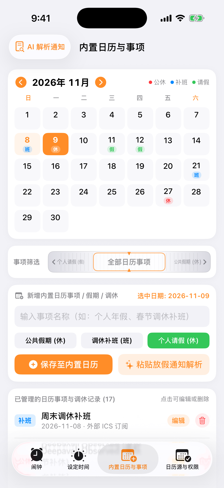
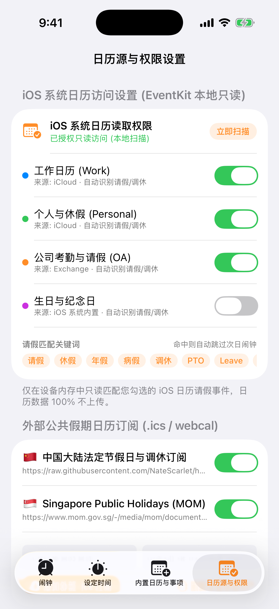
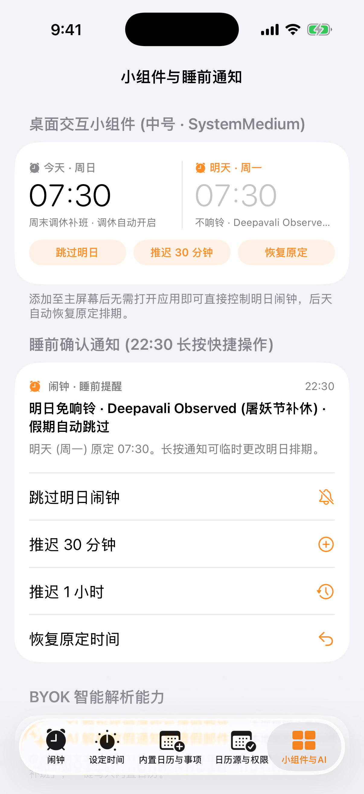

# Vibe 假期闹钟 (VibeAlarm)

**遵循 Apple Crisp Light Theme (清爽浅色主题) 与 Dieter Rams 机械拟物触感设计、懂法定节假日、周末调休补班与个人请假的 100% 本地隐私优先 iOS 闹钟**

[](https://github.com/jstdlee/vibe-alarm/actions/workflows/ci.yml)


<p align="center">
  
</p>

> **设计原则**：采用清爽通透的 **Apple Light Theme (`#F2F2F7` 分组浅色背景 + `#FFFFFF` 纯白卡片 + `#FF6B00` Braun 标志橙)**，并在高频时间调节与筛选项上融入 **Dieter Rams / Braun 机械拟物设计 (`Skeuomorphic Tactile UI`)**：
> - **屏幕中下部左右半圆拟物转盘 (`SemiCircularSkeuomorphicDial`)**：将旋转拨盘布置在双手握持手机时左右拇指最舒适的**屏幕中下半区**——左边缘锚定左半圆机械转盘调 `时 (00–23)`，右边缘锚定右半圆机械转盘调 `分 (00–59)`，带外圈齿轮滚花、放射刻度与中心橙色指针窗口。
> - **横向拟物滚动轴 (`SkeuomorphicHorizontalRoller`)**：以带垂直防滑滚花纹、3D 柱面透视与中心橙色准星的**横向机械滚轴**替代传统下拉菜单（Dropdown），左右拨动即可切换重复周期、假期策略与日历事项筛选。
> - **内置日历与事项管理 + 外部日历订阅 (`.ics`) & iOS 系统日历 (`EventKit`) 访问设置**：底部四栏 Tab 直达，所有数据 100% 在 iPhone 本地沙盒 (`App Group`) 闭环运行。

---

## iOS Simulator 实机截图 (Apple Light Theme)

以下截图均由 GitHub Actions `macos-26` 上的 Xcode iOS Simulator 在浅色模式 (`appearance light`) 下实机运行 `VibeAlarm.app` 截取：

<p align="center">
  
  
  
  
  
</p>

| 1. 闹钟 · 近两日 (`TwoDayDashboardView`) | 2. 设定时间 · 中下部左右半圆转盘 + 横向滚轴 (`DualThumbTimeDialView`) |
| :---: | :---: |
|  |  |
| **Apple 清爽浅色主题 (`#F2F2F7`)**：聚焦**今天与明天（近两日）**排期，清晰展示「周末调休补班 · 调休自动开启」或「不响铃 · 屠妖节补休 · 假期自动跳过」，提供**跳过明日 / 推迟 30 分钟 / 明日照常响铃**单次覆盖操作，后天自动恢复原定排期。 | **人体工学中下部双半圆机械转盘 + 横向拟物滚轴**：顶部数字视窗实时回显；中部采用**横向机械滚轴 (`SkeuomorphicHorizontalRoller`)** 设定重复周期与假期策略；中下部左右屏幕边缘对称布置**左半圆（时 00–23）与右半圆（分 00–59）拟物旋转拨盘**，方便左右手拇指自然旋转。 |

| 3. 内置日历与事项管理 (`HolidayCalendarView`) | 4. 外部日历订阅与 iOS 日历权限设置 (`SettingsView`) |
| :---: | :---: |
|  |  |
| **内置月历网格 + 事项增删改查 (CRUD)**：直观展示每月日期及其 `休`（公休）、`班`（调休补班）、`假`（个人请假）角标；下方配备**横向拟物滚轴筛选器**，支持点选任意日期**新增、编辑或删除**内置日历事项，以及一键打开 BYOK AI 通知解析。 | **iOS 系统日历 (`EventKit`) 访问设置 + 外部 `.ics` 日历订阅**：第一分区展示 iOS 系统日历只读权限状态、可独立勾选的本地日历源（工作日历 / 个人与休假 / 公司 OA 等）及请假匹配关键词；第二分区管理中国国务院法定节假日调休、新加坡 MOM 公共假期及自定义 `.ics / webcal` 外部订阅源。 |

| 5. 桌面交互小组件、22:30 睡前确认通知与 BYOK AI (`WidgetAndBedtimeShowcaseView`) |
| :---: |
|  |
| **无需打开 App**：浅色主题桌面交互小组件 (`SystemMedium` / `SystemSmall`) 直接展示今明两日状态并提供「跳过明日」「推迟 30 分钟」「恢复原定」按钮；每晚 `22:30` 自动推送睡前确认通知，**长按通知**即可一键跳过或推迟明早闹钟。 |

---

## 核心特性

1. **屏幕中下部左右半圆拟物转盘 + 横向拟物滚轴 (`DualThumbTimeDialSheet`)**：
   - **左右半圆机械转盘 (`SemiCircularSkeuomorphicDial`)**：锚定在屏幕中下部左右边缘，外圈 60 齿防滑滚花、放射刻度与中心橙色指针，左手拇指旋 `时`、右手拇指旋 `分`，配合 `UIImpactFeedbackGenerator` 机械棘轮触感。
   - **横向拟物滚轴 (`SkeuomorphicHorizontalRoller`)**：模拟水平镶嵌的机械滚轮轴，替代生硬的传统 Dropdown 菜单，左右滑动即可切换重复周期、假期策略与日历筛选。
2. **完整的内置日历与事项管理 (`HolidayCalendarView`)**：
   - 内置月历视图直观标记 `休` / `班` / `假`，支持对任意日期的假期、调休补班、个人请假事项进行新增、编辑与删除，并支持粘贴放假通知一键智能解析入库。
3. **外部公共假期日历订阅 (`.ics`) 与 iOS 系统日历 (`EventKit`) 访问设置 (`SettingsView`)**：
   - **iOS 系统日历 (`EventKit`) 本地只读访问**：一键授权并勾选需要扫描的本地/iCloud/Exchange 日历，自定义请假匹配关键词（`请假`、`休假`、`年假`、`病假`、`调休`、`PTO`、`Leave`）。
   - **外部 `.ics / webcal` 订阅管理**：内置中国大陆法定节假日调休与新加坡 MOM 公共假期订阅，支持随时启用/停用、添加自定义 `.ics` 链接与一键刷新。
4. **单次推迟/跳过，后天自动恢复 (`NextDayOverride`)**：
   - 无论是点击「跳过明日」还是「推迟 30 分钟」，都只针对**明天那一次**生成带日期戳的临时覆盖 (`targetDate = YYYY-MM-DD`)；明天过后自动失效，**后天自动恢复原定排期**。

---

## 安装与编译指南

### 方式一：下载 GitHub Actions 自动编译的 `.ipa` 与 Simulator 截图

本仓库配置了 GitHub Actions (`macos-26` + Xcode)，每次提交都会自动运行 `VibeAlarmCore` 单元测试、在 iOS Simulator (浅色模式) 中实机运行截图并打包未签名 `.ipa`：

1. 打开 [**GitHub Actions — CI 工作流页面**](https://github.com/jstdlee/vibe-alarm/actions/workflows/ci.yml)。
2. 点进最新一次构建记录，在底部 **Artifacts** 下载 **`VibeAlarm-unsigned-ipa`**，内含 `dist/VibeAlarm.ipa` 与 `dist/screenshots/` 实机截图。
3. 使用 **AltStore / SideStore / Sideloadly / TrollStore** 或个人 Apple 开发者证书签名安装到 iPhone。

### 方式二：从源码本地编译 (Xcode + XcodeGen)

```bash
git clone https://github.com/jstdlee/vibe-alarm.git
cd vibe-alarm

# 运行核心包单元测试
swift test --package-path VibeAlarmCore

# 生成 Xcode 工程并打开
brew install xcodegen
xcodegen generate
open VibeAlarm.xcodeproj
```

---

## License

MIT License © [jstdlee](https://github.com/jstdlee)
