# VibeAlarm

**A 100% on-device, privacy-first iOS alarm that understands public holidays, weekend makeup workdays and personal leave.**

[](https://github.com/jstdlee/vibe-alarm/actions/workflows/ci.yml)


> **Two appearances, one alarm.** Standard is the default: system lists, a wheel for the time, and the iPhone light, dark, and contrast settings. Bedside Clock is the alternate: warm paper or a charcoal case, and two rotary discs for the hour and the minute. Choose Appearance at the top of Sources. The choice is stored on this iPhone and applies immediately, including the Home Screen widgets.

---

## iOS Simulator Screenshots

These captures come from GitHub Actions ([run 42829876435](https://github.com/jstdlee/vibe-alarm/actions/runs/42829876435)), one set for Standard and one for Bedside Clock. Light mode is the default. The wake time editor is also captured in dark mode. The same screens on a 375 × 667 phone are in `docs/screenshots/small/standard` and `docs/screenshots/small/bedside`.

### Standard

<p align="center">
  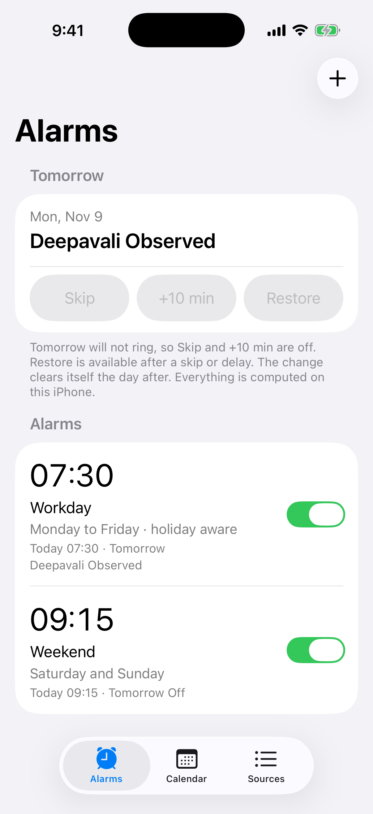
  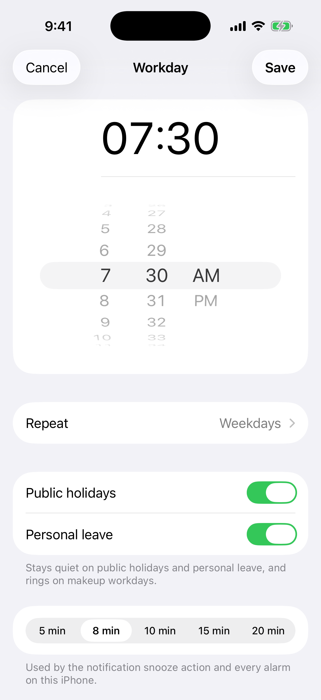
  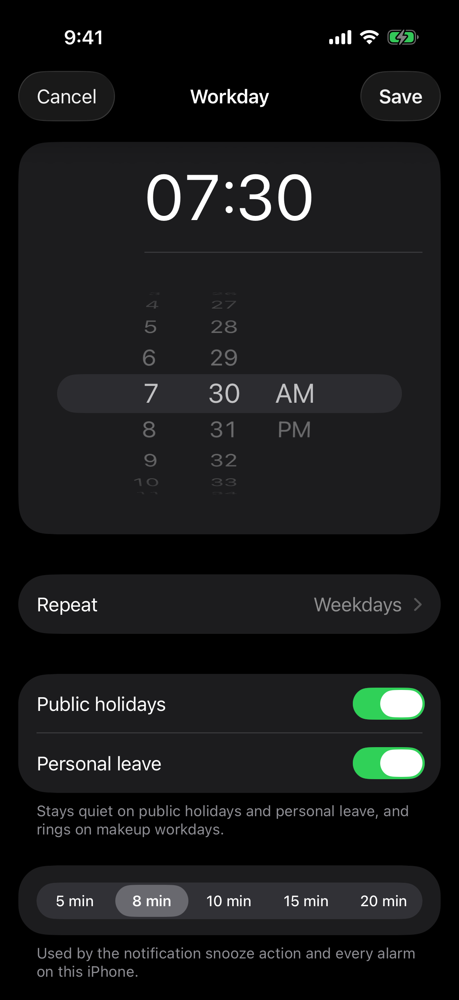
  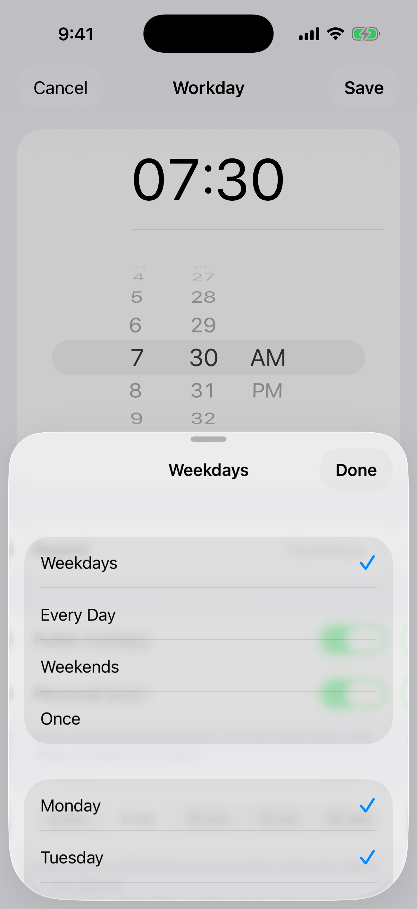
  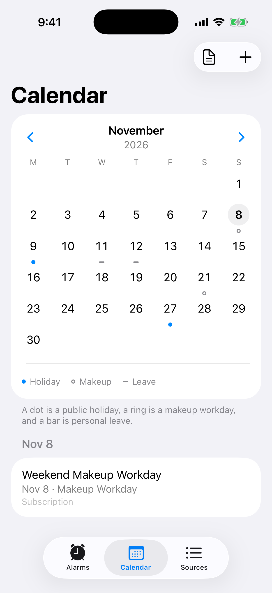
</p>

<p align="center">
  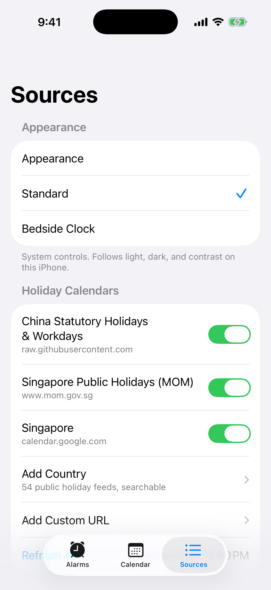
  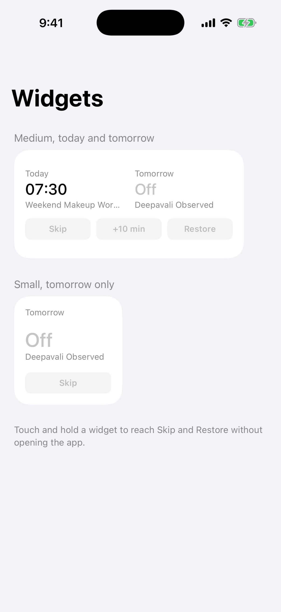
  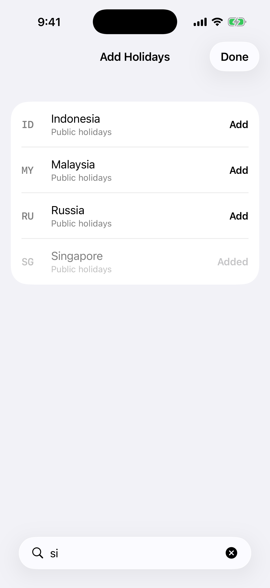
  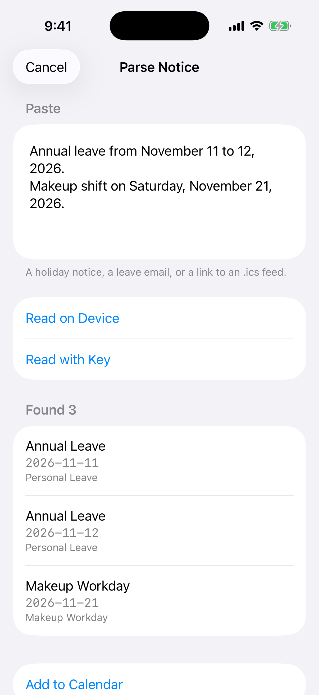
</p>

| Alarms | Wake time editor, light |
| :---: | :---: |
|  |  |
| A grouped list. Tomorrow shows the date and why it will or will not ring. `Skip`, `+10 min`, and `Restore` act on tomorrow only. Each alarm row has its time, repeat summary, today and tomorrow, and a toggle. | The system wheel sets the time. Repeat opens its sheet. Public holidays and Personal leave are separate switches. Snooze is a segmented control. |

| Wake time editor, dark | Repeat sheet |
| :---: | :---: |
|  |  |
| The same editor in dark mode: wheel, repeat row, the two skip switches, and snooze. | Presets on top (Weekdays, Every Day, Weekends, Once) and each weekday below, with checkmarks. |

| Calendar | Sources |
| :---: | :---: |
|  |  |
| A month grid. Tap a day to filter the entries below. Add, edit, or delete any entry. | Appearance chooses Standard or Bedside Clock. Holiday feeds each have a toggle, plus Add Country and a custom `.ics` URL. iOS Calendar access is read-only, one toggle per calendar. |

| Widgets | Holiday catalog |
| :---: | :---: |
|  |  |
| Small and medium Home Screen widgets with `Skip`, `+10 min`, and `Restore`. | A catalog of 54 national public holiday feeds. Search by country name or code and tap Add. |

<p align="center">
  <br>
  Paste a leave notice or an HR email. The on-device parser, or your own API key, turns it into dated entries before anything is saved.
</p>

### Bedside Clock

<p align="center">
  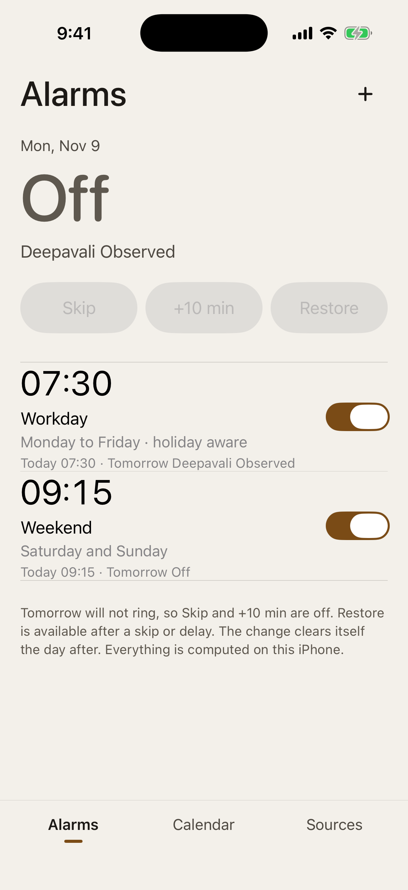
  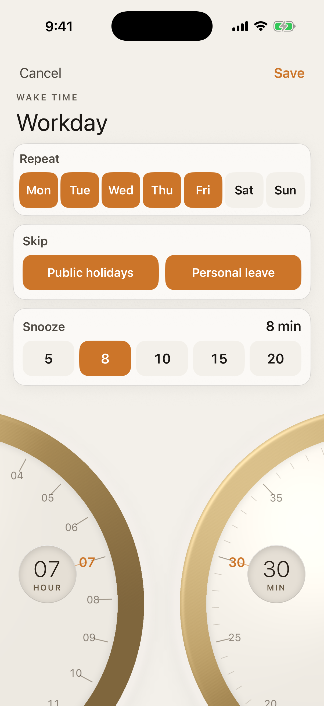
  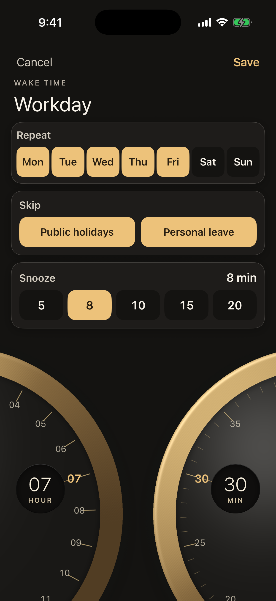
  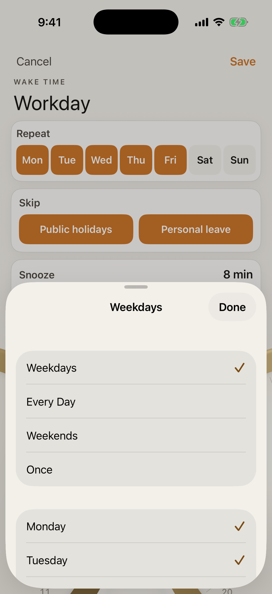
  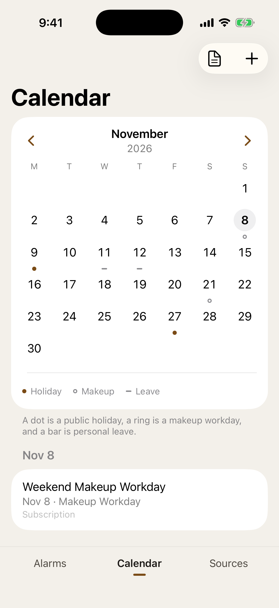
</p>

<p align="center">
  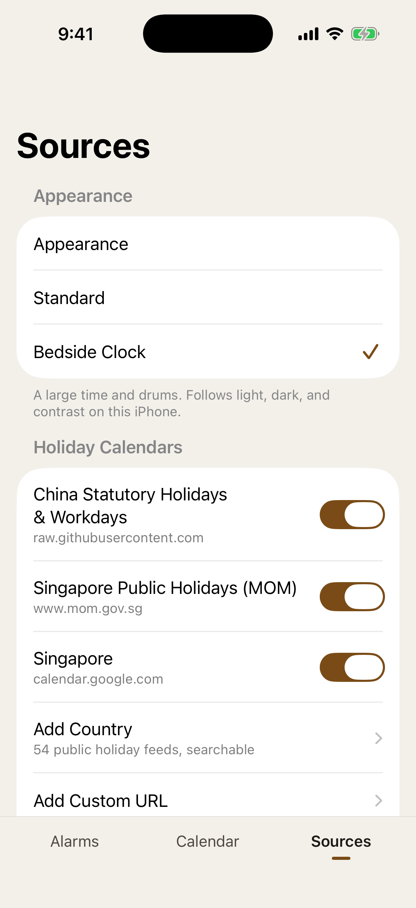
  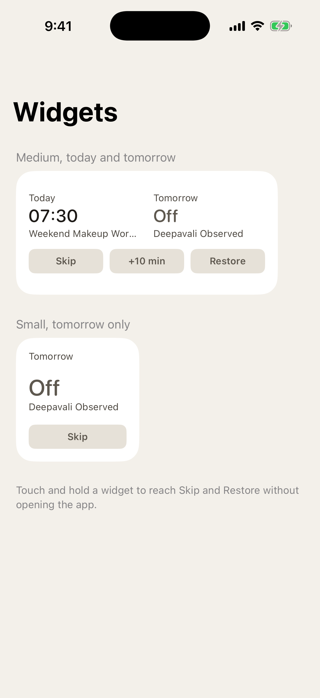
  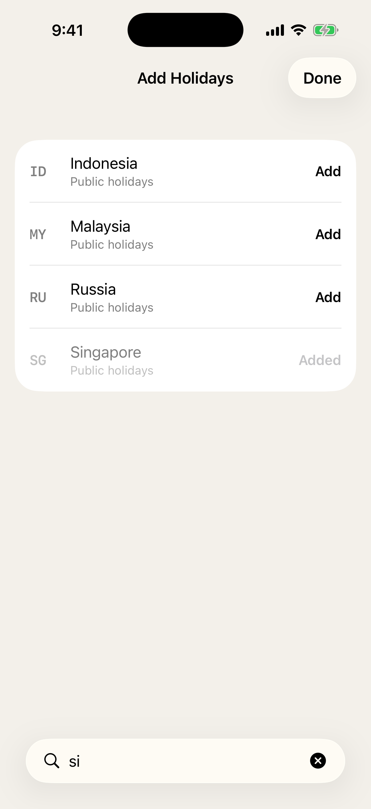
  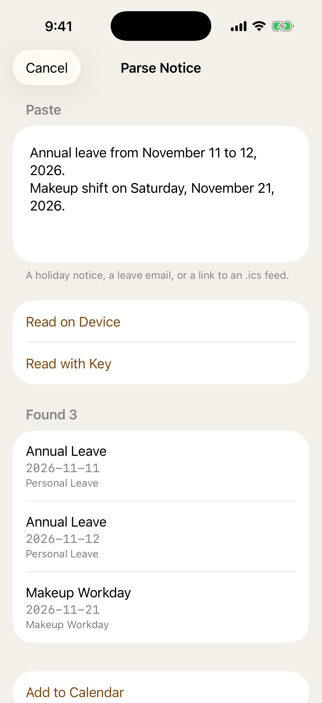
</p>

| Alarms | Wake time editor, light |
| :---: | :---: |
|  |  |
| Warm paper, a large tomorrow status, and the same three tomorrow keys. Alarm rows keep the time, label, repeat summary, and toggle. | Monday through Sunday are day keys. Skip offers Public holidays and Personal leave. Snooze is a row of minute keys. Two half-discs set the hour and the minute. |

| Wake time editor, dark | Repeat sheet |
| :---: | :---: |
|  |  |
| Charcoal faces and antique brass rings. The day keys, skip keys, and snooze keys use the same layout in dark mode. | The repeat sheet over the bedside editor: Weekdays, Every Day, Weekends, Once, then each weekday. |

| Calendar | Sources |
| :---: | :---: |
|  |  |
| The same month grid and entry list, on the bedside paper. | Appearance is at the top. Bedside Clock is selected. Holiday feeds, Add Country, and a custom URL follow. |

| Widgets | Holiday catalog |
| :---: | :---: |
|  |  |
| The same small and medium widgets, tinted for Bedside Clock. | The same 54-country catalog, on the bedside surface. |

<p align="center">
  <br>
  Paste a notice. The parser still turns it into personal leave, a public holiday, or a makeup workday before anything is saved.
</p>

---

## Core Features

1. **Alarms list with next-day quick keys** — `Skip`, `+10 min` and `Restore` apply to tomorrow only and clear themselves the day after.
2. **Appearance** — Standard uses system controls and a wheel for the wake time. Bedside Clock uses a paper or charcoal surface and two half-discs, hour and minute, for the wake time. Sources → Appearance stores the choice in the App Group.
3. **Three-source holiday engine, all on device**:
   - External `.ics` subscriptions, including China's statutory holidays and makeup workdays, Singapore MOM, and a searchable catalog of 54 national feeds. Google feeds are classified so observances and regional-only days do not silently skip a workday.
   - Read-only `EventKit` scanning of chosen calendars against leave keywords.
   - A BYOK parser for pasted notices, with an offline rule-based fallback and the key held in the iOS Keychain.
4. **Snooze interval** — stored in the shared App Group store, default `8` minutes, used by the notification snooze action and the scheduler.
5. **Privacy** — no backend, no account, no analytics. Alarm rules, overrides and calendar entries live in the App Group sandbox; events never leave the phone.

---

## Architecture

- **`VibeAlarmCore`** — a dependency-free Swift package: scheduling engine, models, `.ics` parser, holiday catalog, BYOK service, shared store. Unit tested.
- **`iOS/App`** — the SwiftUI app: `AlarmListView`, `TimeEditorView`, `HolidayCalendarView`, `SettingsView`, `HolidayCatalogSearchSheet`, `BYOKInputSheet`.
- **`iOS/Shared`** — appearance tokens, widget views, App Intents for Siri and Shortcuts, and the notification scheduler.
- **`iOS/Widget`** — the WidgetKit extension with small and medium widgets.

## Build & Test

```bash
git clone https://github.com/jstdlee/vibe-alarm.git
cd vibe-alarm

swift test --package-path VibeAlarmCore

brew install xcodegen
xcodegen generate
open VibeAlarm.xcodeproj
```

GitHub Actions (`macos-26` + Xcode) runs the core tests, builds the app and widget extension, captures real Simulator screenshots on two screen sizes, and packages an unsigned `.ipa`. Download the `VibeAlarm-unsigned-ipa` artifact from the [CI workflow](https://github.com/jstdlee/vibe-alarm/actions/workflows/ci.yml) to sideload it.

---

## License

MIT License © [jstdlee](https://github.com/jstdlee)
